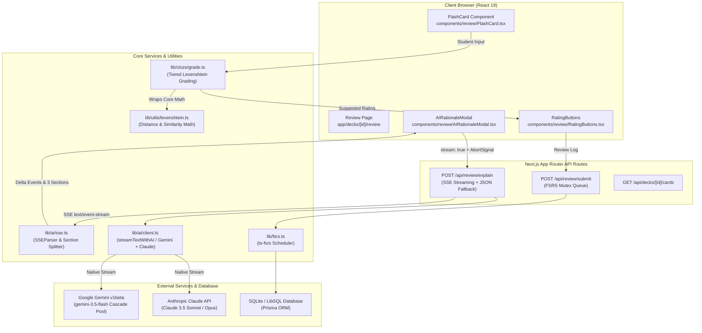
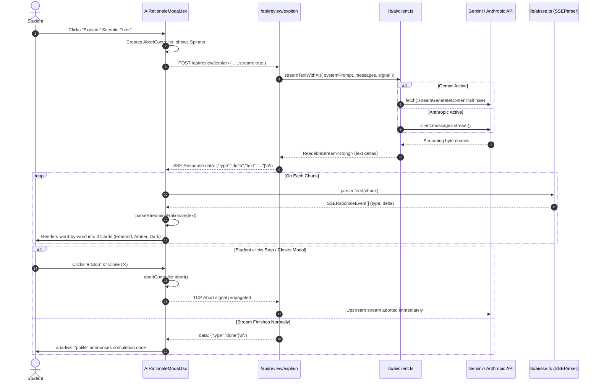
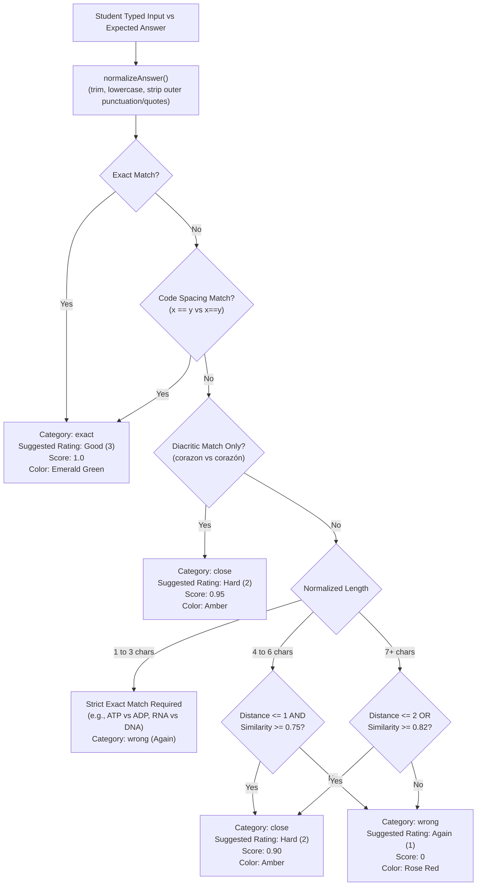

# Cadence: Comprehensive Architecture & AI Engineering Handoff
**Target Audience**: Claude (System Architect & Brain of Cadence) / AI Engineering Agent  
**Repository**: [https://github.com/markwlsn/cadence](https://github.com/markwlsn/cadence)  
**Primary Branch**: `main`  
**Current Release Version**: `v0.2.2-dev` (Production Health Score: 100/100)  
**Last Updated**: October 12, 2026  

---

## 1. Project Identity & Philosophy

**Cadence** is an academic-grade, minimalist medical and STEM study web application built on cognitive science principles:
1. **Active Cognitive Retrieval**: Moving students away from passive recognition toward active recall through fill-in-the-blank cloze typing with typo-tolerant grading.
2. **Pedagogical Socratic Scaffolding**: Providing immediate, real-time streaming contrast explanations (Causal Mechanism vs. Cognitive Trap vs. Anchor Takeaway) rather than dry answer keys.
3. **Spaced Repetition (FSRS-4.5)**: Optimizing memory stability and retention using the Free Spaced Repetition Scheduler algorithm with automated rating suggestions.
4. **Apple-Inspired Academic Aesthetic**: Monochrome design tokens, zero cognitive distraction, instant sub-millisecond local interactions, and strict accessibility (WCAG AA).

---

## 2. Technical Stack

| Layer | Technology | Key Details & Constraints |
| :--- | :--- | :--- |
| **Framework** | **Next.js 16.3.8** (App Router, Turbopack) | Server and Client Components, Node.js runtime for API streaming. |
| **Language & Engine** | **TypeScript 5.x**, **React 19.2.8** | Strict types, React 19 compiler hooks and transitions. |
| **Styling & Tokens** | **Tailwind CSS v4** | CSS variables (`var(--color-*)`), light/dark mode with theme toggle. |
| **Persistence / ORM** | **Prisma 6.19.3** + **LibSQL / SQLite** | `@prisma/adapter-libsql`, zero external database dependencies for local dev. |
| **Spaced Repetition** | **ts-fsrs 5.4.2** | Implements FSRS scheduling matrix with concurrency mutex. |
| **AI LLM Engine** | **Dual-Provider Architecture** | **Google Gemini** (REST API v1beta cascade) + **Anthropic Claude** (`@anthropic-ai/sdk`). |
| **Streaming** | **Server-Sent Events (SSE)** | Standard Web `ReadableStream` yielding `text/event-stream` chunks. |
| **Testing** | **ts-node / Custom Test Harness** | `npm run test:unit` running `scripts/test-unit.ts` (**41 passing tests**). |

> [!IMPORTANT]
> **Cadence Architectural Invariants**:
> - **NO `src/` directory**: All code lives in root-level `app/`, `components/`, `lib/`, `types/`, and `scripts/`. Paths are aliased `@/*` $\rightarrow$ `./*`.
> - **Single Source of Truth for Types**: `types/index.ts` is the sole authority for shared contracts (`Card`, `Deck`, `ExplainRequest`, `ExplainResponse`, `SSERationaleEvent`). Never redefine shared types in local modules.
> - **Lint Baseline Integrity**: Main has 64 pre-existing ESLint errors confined to legacy QA scripts. **NEVER modify `eslint.config.mjs`** to downgrade rules or ignore checks without architectural approval.
> - **Zero Dependency Policy**: Do not add heavy npm packages without verifying if native browser/Node APIs or standard REST endpoints satisfy the requirement.

---

## 3. High-Level System Architecture



---

## 4. Key Subsystems & Workflows

### A. Streaming Socratic Rationale Tutor



#### Pre-Token Failure Recovery (Spec Invariant)
If an error occurs before the first token arrives (network timeout, rate limit, quota exceeded), `AIRationaleModal` catches the failure and **retries once automatically** using the non-streaming JSON path (`stream: false`). If that also fails, it displays a friendly error banner without crashing.

---

### B. Active-Recall Cloze Typo Tolerance Matrix



---

## 5. File Map & Responsibility Directory

### Shared Contracts
- [`types/index.ts`](file:///C:/Users/User.MIS/Documents/Projects/cadence/types/index.ts):
  - `Card`: Flashcard entity with FSRS stability, difficulty, due date, type (`basic | cloze | mcq`).
  - `Deck`: Deck entity with source type (`pdf | text | image`).
  - `ExplainRequest`: Payload for rationale API with optional `stream?: boolean`.
  - `ExplainResponse`: Structured JSON response schema for non-streaming explanations.
  - `SSERationaleEvent`: Union type `{ type: 'delta', text: string } | { type: 'done' } | { type: 'error', message: string }`.

### AI & Streaming Layer
- [`lib/ai/sse.ts`](file:///C:/Users/User.MIS/Documents/Projects/cadence/lib/ai/sse.ts):
  - `formatSSEEvent(event)`: Serializes SSE message lines.
  - `SSEParser`: Stateful stream parser handling chunk splits and multi-event packets.
  - `parseStreamingRationale(rawText)`: Progressive markdown heading extractor mapping streams into:
    1. `correctPrinciple` (Causal Mechanism)
    2. `misconception` (Cognitive Trap & Distractor Breakdown)
    3. `keyTakeaway` (Active-Recall Anchor)
- [`lib/ai/client.ts`](file:///C:/Users/User.MIS/Documents/Projects/cadence/lib/ai/client.ts):
  - `getAIProvider()`: Resolves `gemini` or `anthropic` based on env keys.
  - `streamTextWithAI()`: Web `ReadableStream` producer supporting both Gemini REST SSE and Anthropic Messages SDK.
  - `generateTextWithAI()`: Non-streaming text generator with automatic Gemini 4-model cascade.
- [`app/api/review/explain/route.ts`](file:///C:/Users/User.MIS/Documents/Projects/cadence/app/api/review/explain/route.ts):
  - Unified endpoint handling both streaming (`stream: true`) and non-streaming (`stream: false`).
  - Contains in-memory sliding-window IP rate limiting (60 req/min).

### Cloze & Review Layer
- [`lib/cloze/grade.ts`](file:///C:/Users/User.MIS/Documents/Projects/cadence/lib/cloze/grade.ts):
  - Wraps [`lib/utils/levenshtein.ts`](file:///C:/Users/User.MIS/Documents/Projects/cadence/lib/utils/levenshtein.ts).
  - Evaluates student input against expected answers with length-tiered tolerance and diff indexing.
- [`components/review/AIRationaleModal.tsx`](file:///C:/Users/User.MIS/Documents/Projects/cadence/components/review/AIRationaleModal.tsx):
  - Socratic rationale modal UI with word-by-word streaming, pre-token loading spinner, "⏹ Stop" button, `AbortController` cancellation, and polite `aria-live` completion announcement.
- [`components/review/FlashCard.tsx`](file:///C:/Users/User.MIS/Documents/Projects/cadence/components/review/FlashCard.tsx):
  - Interactive card component with cloze input, first-letter hints, persistent typing toggle (`localStorage`), and skip-to-flip flow.
- [`components/review/RatingButtons.tsx`](file:///C:/Users/User.MIS/Documents/Projects/cadence/components/review/RatingButtons.tsx):
  - FSRS rating buttons with visual glowing ring and `"★ Suggested"` badge.

### Automated Testing
- [`scripts/test-unit.ts`](file:///C:/Users/User.MIS/Documents/Projects/cadence/scripts/test-unit.ts):
  - Canonical unit test suite executing under `npm run test:unit`.
  - **41 tests total**: Quality Gate (R-01), Chunking bounds (R-06), Types (R-09, R-10), Cloze grading & typo tiers, Non-cloze invariants, SSE formatting, chunk fragmentation reassembly, multi-event parsing, error events, and section splitting.

---

## 6. Testing & Quality Verification Baseline

When taking over development on any machine, verify the following baseline commands:

```bash
# 1. Run unit tests (must report 41 passed, 0 failed)
npm run test:unit

# 2. Verify TypeScript compilation (must exit code 0)
npx tsc --noEmit

# 3. Verify ESLint (must not exceed baseline 64 errors, 0 in feature files)
npm run lint

# 4. Verify Next.js production build (must pass 21/21 routes)
npm run build
```

---

## 7. Machine Migration Runbook (For Your Laptop)

Follow these steps when checking out this repository on your laptop:

### Step 1: Clone Repository
```bash
git clone https://github.com/markwlsn/cadence.git
cd cadence
```

### Step 2: Install Dependencies
```bash
npm install
```

### Step 3: Configure Environment Variables
Create `.env.local` in the project root:
```env
# Database (SQLite / LibSQL)
DATABASE_URL="file:./prisma/dev.db"

# AI Provider Configuration (Provide at least one)
# Options: 'gemini' | 'anthropic'
AI_PROVIDER="gemini"
GEMINI_API_KEY="your-google-ai-studio-api-key"
# ANTHROPIC_API_KEY="your-anthropic-api-key"

# Optional Model Overrides
GEMINI_MODEL="gemini-3.5-flash"
ANTHROPIC_MODEL="claude-opus-4-5"
```
*(Note: If no API key is provided, Cadence automatically uses its deterministic heuristic streaming fallback for offline development).*

### Step 4: Initialize SQLite Database
```bash
npx prisma generate
npm run db:push
npm run db:seed
```

### Step 5: Execute Test Suite & Start Dev Server
```bash
npm run test:unit
npm run dev
```
Navigate to `http://localhost:3000`.

---

## 8. Strategic Roadmap & Next Recommendations for Claude

When Claude takes the lead on future sprints, prioritize these architectural enhancements:

1. **Multiple Accepted Answers for Cloze (`|` alternatives)**:
   - *Current State*: `gradeClozeAnswer` accepts a single `expectedAnswer`.
   - *Recommendation*: Support `expectedAnswer.split('|')` in `gradeClozeAnswer` and `parseCloze`, evaluate against each candidate, and select the highest score.
2. **Audio Speech Synthesis for Socratic Rationales**:
   - Integrate Web Speech API (`speechSynthesis`) or streaming audio TTS to read the 3-part rationale aloud for auditory learners.
3. **Anki `.apkg` Deck Import & Export**:
   - Provide two-way interoperability with Anki collections, converting Anki `{{c1::...}}` clozes directly into Cadence interactive flashcards.
4. **Institutional Teacher Dashboard & Learning Analytics**:
   - Aggregate anonymous misconception metrics to highlight which cognitive traps trip up the highest percentage of students.


---

## 9. Cadence v0.2.3 Status: Exam Date Pacing & Hardened Subsystems
- **Deck-Level Exam Date**: Nullable `examDate DateTime?` column added to `Deck` in SQLite/Prisma schema.
- **Pure Helpers in `lib/exam-pacing.ts`**:
  - `validateExamDate(input, now)`: Validates ISO strings, rejects past dates, numbers, malformed strings with 400. Stores as UTC midnight.
  - `daysUntilExam(examDate, now, timezoneOffsetMinutes)`: Calculates calendar days relative to user local timezone across month and leap day boundaries.
- **API & UI Hydration**:
  - `PATCH /api/decks/:id` validates and stores `examDate`.
  - `DeckDetailClient.tsx` reads from server, handles one-time migration from legacy `cadence_exam_date_<id>` localStorage, and shows saving/error states.
- **Test Baseline**: 111 unit tests passing in `scripts/test-unit.ts`.
